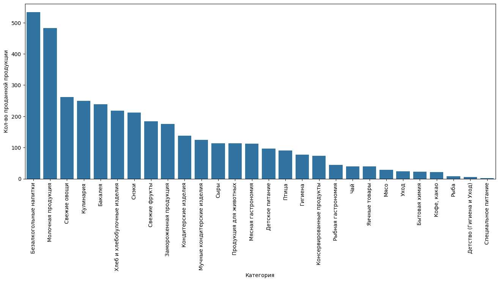
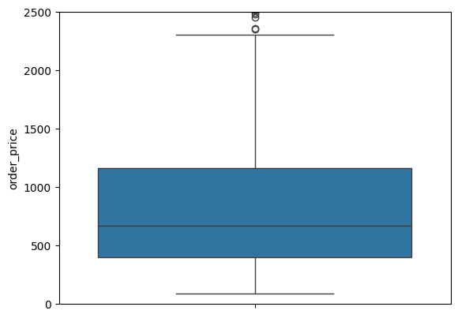
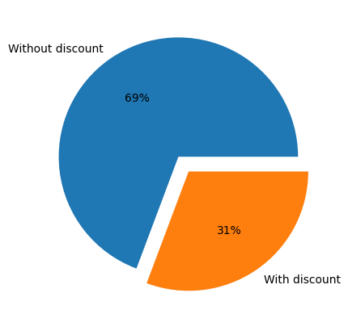
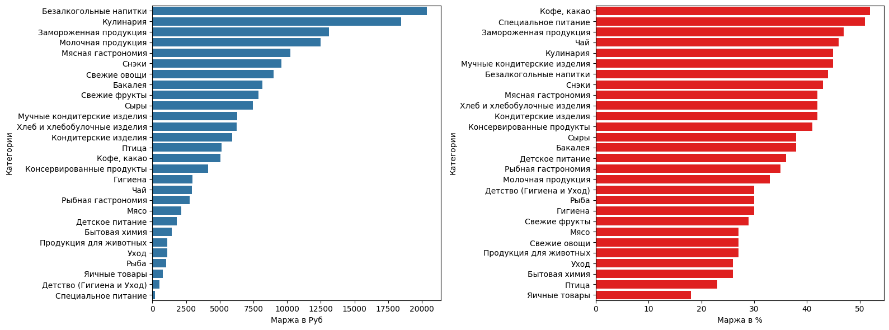

# Кейс 5. Исследовательский и ABC-анализ сервиса доставки

> Тестовое задание на позицию аналитика. Разведочный анализ заказов сервиса доставки продуктов: что продаётся лучше всего, сколько зарабатываем и какие подкатегории формируют ядро ассортимента.

**Стек:** Python, pandas, numpy, seaborn, matplotlib · **Код:** [main.ipynb](./main.ipynb) · **Полное условие:** [TASK.md](./TASK.md)

## Задача

По выгрузке заказов и справочнику товаров ответить на шесть вопросов бизнеса:

1. Какая товарная категория самая ходовая (по штукам)?
2. Как продажи внутри категорий (`level1`) распределены по подкатегориям (`level2`)?
3. Каким был средний чек 13.01.2022?
4. Какую долю в категории «Сыры» занимают продажи по промо?
5. Какая маржа по категориям — в рублях и в процентах?
6. Какие подкатегории формируют ядро ассортимента (ABC-анализ по количеству и по сумме продаж)?

## Данные

Две таблицы: `orders` (заказы: id заказа, время, товар, количество, базовая и фактическая цена) и `products` (справочник: себестоимость, категория `level1`, подкатегория `level2`, название). В `orders` 3 323 строки. Таблицы объединены по `product_id`; для всех заданий, кроме среднего чека, товары без записи в справочнике исключены (как и разрешено условием).

## Что сделано и что получилось

### 1. Самая ходовая категория

Лидер — **безалкогольные напитки (534 шт.)**, на втором месте молочная продукция (483 шт.). Третье место (свежие овощи, 262 шт.) почти вдвое ниже.



### 2. Распределение по подкатегориям

Для каждой подкатегории посчитана доля в штуках от продаж своей категории. Во многих категориях выбор сводится к одной подкатегории:

| Категория | Подкатегория | Доля |
|---|---|---|
| Кулинария | Готовые блюда | 99,2% |
| Снэки | Снэки соленые | 84,9% |
| Мучные кондитерские изделия | Мучные кондитерские изделия | 83,9% |
| Кофе, какао | Кофе | 71,4% |
| Свежие овощи | Корнеплоды, зелень и прочие овощи | 59,9% |

Шесть категорий (например, Птица, Яичные товары, Хлеб) состоят из одной подкатегории — доля 100%.

### 3. Средний чек за 13.01.2022

**915,64 ₽** при 544 заказах. Медиана — **666,5 ₽**, максимум 5 518 ₽, минимум 84 ₽. Среднее заметно выше медианы: распределение скошено вправо из-за редких крупных заказов, поэтому «типичный» заказ ближе к медиане. Расчёт сделан по всем заказам, включая позиции, которых нет в справочнике.



### 4. Доля промо в категории «Сыры»

**30,7%** проданных единиц (35 шт.) ушли по акционной цене. Промо определялось как расхождение `regular_price` и `price`.



### 5. Маржа по категориям

Маржа = выручка − себестоимость (с учётом количества); процент считался как суммарная прибыль / суммарная выручка по категории, а не как среднее по товарам.



- **В рублях** лидируют безалкогольные напитки, кулинария и замороженная продукция.
- **В процентах** — кофе/какао, специальное питание и замороженная продукция.
- Замороженная продукция сильна по обоим показателям. «Специальное питание» маржинально в %, но почти ничего не приносит в рублях из-за малых продаж. Самые низкие проценты у яичных товаров и птицы.

### 6. ABC-анализ по подкатегориям

Подкатегории отсортированы по убыванию, посчитана накопленная доля: **A** — до 80%, **B** — до 95%, **C** — остальное. Анализ сделан по количеству и по сумме продаж, затем буквы объединены в итоговую группу (например, `AC` — много штук, но мало денег). Анализ выполнен на уровне подкатегорий: данных за короткий период мало для устойчивой оценки по отдельным товарам.

В группу **AA** (ядро ассортимента) входят, например: готовые блюда, мягкие и твёрдые сычужные сыры, мороженое, питьевая вода, соковая продукция, колбасы, яйцо куриное, хлеб и хлебобулочные изделия.

## Выводы

- Спрос сконцентрирован: напитки и молочная продукция заметно опережают остальные категории.
- Внутри большинства категорий ассортимент по продажам сводится к одной-двум подкатегориям.
- Оборот и маржинальность не совпадают: категории с высоким % маржи не всегда дают много рублей — решения по ассортименту стоит принимать, глядя на оба показателя.
- Почти треть продаж сыров идёт по промо — стоит оценить, не отдаём ли маржу там, где спрос есть и без скидки.
- Средний чек (≈916 ₽) завышен крупными заказами, для отчётности лучше показывать его вместе с медианой.

## Как запустить

```bash
pip install -r requirements.txt
jupyter notebook main.ipynb
```
