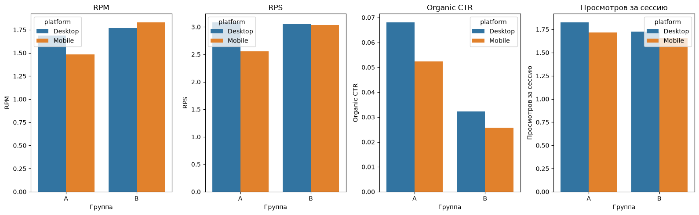

# A/B-тест NewsPortal: платные блоки наверху ленты

**Вывод:** платные блоки наверху (вариант B) повышают доход: RPS +10,5%, RPM +15,5%, но органические клики падают вдвое (−51,7%), а просмотры за сессию снижаются на 4,4%.
**По платформам:** на Mobile рост дохода заметный (RPS +18,8%), на Desktop его почти нет (RPS −1,2%), а просмотры за сессию падают сильнее (−5,5%).
**Рекомендация:** предварительно B выгоден на Mobile, на Desktop выгоды не видно. Значимость различий не проверялась, перед раскаткой её нужно проверить.

## Задача

Под статьёй издателя показывается лента из 5 блоков: платные (реклама, приносят доход при клике) и органические (ссылки на другие статьи издателя).

- **Группа A (контроль):** сверху 1 органический блок, снизу 4 платных.
- **Группа B (тест):** сверху 4 платных блока, снизу 1 органический.

**Вопрос бизнеса:** стоит ли ставить платные блоки наверх вместо органического, или потеря читательской вовлечённости съест прирост дохода?

## Данные

7 дней (2019-03-01 – 2019-03-07), 2 платформы (Desktop, Mobile), несколько издателей. Одна строка = дата × издатель × платформа × группа. Колонки: просмотры страниц, видимые просмотры, сессии, доход, клики по платным и органическим блокам.

## Что сделано

1. **Проверка данных:** пропусков, дублей и нарушений ключа нет, пары A/B полные.
2. **Проверка деления трафика:** доля A по просмотрам 49,1%, по сессиям 48,0%.
3. **Метрики:** Visibility Rate, Paid CTR, Organic CTR, RPM, RPS, просмотры за сессию. Считаются как сумма / сумма по группе, а не как среднее долей по строкам: у строк разный трафик, среднее долей давало бы неверный вес.
4. **Сравнение A и B** в целом и отдельно по Mobile и Desktop.

## Результаты

**Всего (разница B к A):**

| Метрика | A | B | Разница |
|---|---|---|---|
| Visibility Rate | 0.283 | 0.260 | −8,1% |
| Paid CTR | 0.017 | 0.019 | +11,8% |
| Organic CTR | 0.058 | 0.028 | −51,7% |
| RPM | 1.564 | 1.806 | +15,5% |
| RPS | 2.751 | 3.039 | +10,5% |
| Просмотров за сессию | 1.759 | 1.682 | −4,4% |

**По платформам (разница B к A):**

| Метрика | Desktop | Mobile |
|---|---|---|
| Visibility Rate | −8,1% | −7,6% |
| Paid CTR | +6,3% | +17,2% |
| Organic CTR | −52,7% | −50,9% |
| RPM | +4,6% | +23,3% |
| RPS | −1,2% | +18,8% |
| Просмотров за сессию | −5,5% | −3,6% |

## Трейд-офф

- **Mobile:** рост дохода (RPS +18,8%) перевешивает небольшую потерю глубины чтения (−3,6%). Вариант B выгоднее.
- **Desktop:** дохода на сессию не прибавилось (−1,2%), а просмотров за сессию стало меньше на 5,5%. Выгоды от B не видно.
- Общий рост RPS в основном обеспечен Mobile: по общей цифре этого не видно, поэтому нужен срез по платформам.

## Ограничения

- **Значимость различий не проверялась.** Выводы описательные, часть разниц (например, RPS на Desktop) может быть шумом.
- **Короткий тест:** 7 дней, эффект новизны и день недели не проверены.
- **Деление трафика не идеально:** доля A по сессиям 48,0%, причина не выяснена. RPS и просмотры за сессию (знаменатель «сессии») надёжны меньше, чем метрики на просмотр страницы.
- **Неизвестна единица деления трафика** (страницы, сессии или пользователи).
- **Visibility Rate в B ниже на 8%:** причина не исследовалась.
- **Только краткосрочные метрики:** нет данных об удержании читателей и их возврате на сайт.

## Что дальше

- Проверить значимость различий после изучения статистики (доверительные интервалы, bootstrap).
- Повторить тест на 3–4 недели, особенно на Desktop.
- Посмотреть эффект по издателям.
- Уточнить у заказчика единицу деления трафика и причину перекоса по сессиям.

**Стек:** Python, pandas, seaborn, matplotlib.
